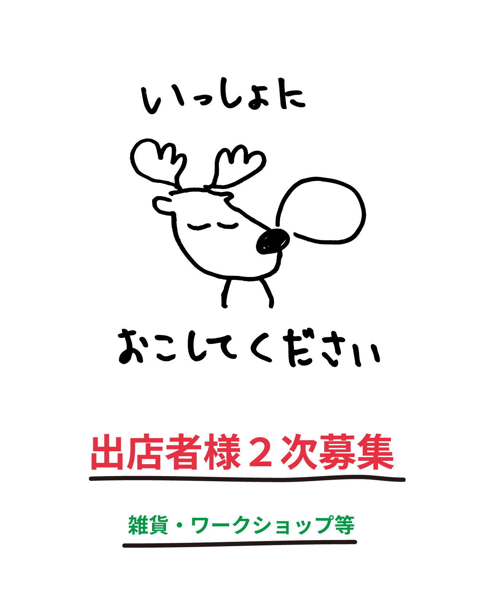

クリスマスの余韻を、公園で。

クリスマスが過ぎても、冬の楽しみは、まだ終わらない。

音楽が流れる冬の夜。心ときめく雑貨やハンドメイドとの出会い。素敵なプレゼントたちがあなたを待っているかも。

お気に入りを見つけたり、音楽に耳を傾けたり、大切な人と冬の夜を楽しんだり。

いつもの公園で過ごす時間が、少し特別な思い出になりますように。

クリスマスのその先にある、とっておきの時間を。

## 開催概要

| 項目 | 内容 |
|---|---|
| 名称 | Christmas Market in FUKUYAMA |
| 日程 | 2026年12月25日（金）〜27日（日） |
| 時間 | 16:00〜21:00 |
| 会場 | 福山中央公園（広島県福山市霞町1丁目10） |
| 入場 | 無料・予約不要 |
| 主催 | Good Day Neighbors PRESENTS |

## もう少しだけ、クリスマスを。

25日の夜が明けると、街はすこし静かになります。ツリーが片づけられ、はなやかな音楽がやんで、「今年も終わったな」という気持ちになる。

その、ちょっとさみしい3日間を、まるごと楽しい時間にしてしまおう。それがこのマーケットです。

**焚き火**にあたりながら、湯気の立つ飲みものを飲む。お店をのぞいて、自分へのごほうびを見つける。音楽を聴きながら、暗くなっていく空をながめる。

16:00から21:00まで、好きな時間に来て、好きなだけいてください。入場は無料、出入りも自由です。

## 出店・音楽

雑貨やワークショップのお店、飲食、そして音楽。日によって内容が変わります。

決まり次第、この記事とInstagramで更新していきます。

## 出店者様を2次募集しています

雑貨・ワークショップなどの出店者様を募集しています。

| 項目 | 内容 |
|---|---|
| 募集する業種 | 雑貨販売・ワークショップなど |
| 出店料 | 1日 ¥3,000（税別） |
| 開催日 | 2026年12月25日（金）・26日（土）・27日（日） |
| 時間 | 16:00〜21:00 |
| 会場 | 福山中央公園 |

### 出店にあたってのお願い

1. 無理のない範囲で「出店の装飾」や「スタッフのコスチューム」などに、クリスマスのものを取り入れていただくようお願いいたします。
2. クリスマスのテーマに沿った「雑貨販売」「ワークショップ」などのご出店をお願いいたします。
3. 応募多数の場合、3日間出店いただける方を優先的にご案内いたします。
4. 飲食出店の募集はしておりません。

### お申し込み

申し込みは、下記のGoogleフォームよりお願いいたします。

[出店申込フォームへ進む](https://forms.gle/jSJgh15mgfYyMHbb7)

ご不明な点は、Instagramのダイレクトメッセージ、または公式LINEからお問い合わせください。

## 最新情報

出店者や当日の内容は、決まり次第この記事とInstagramでお知らせします。
